<p align="center"></p>

<p align="center">
  
  
  
  
  
  
</p>

<p align="center">
  <strong>A hands-on digital twin lab for engineering students.</strong><br/>
  Plug an ESP32 kit into USB, and the browser finds your parts and mirrors your rig live.
</p>

<p align="center">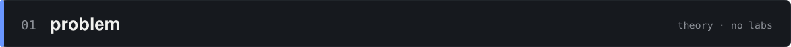</p>

Most engineering students in Pakistan learn embedded systems from slides. Real labs are expensive, so few students ever build a system, break it and debug it before they graduate.

OmniTwin puts that lab on a student's own desk: a low-cost kit, a USB cable and a browser.

<p align="center">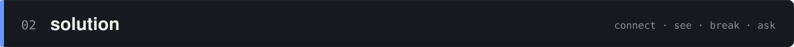</p>

<p align="center">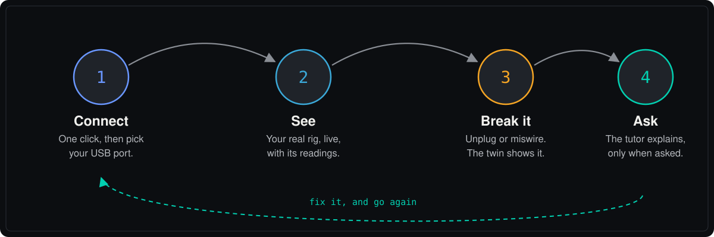</p>

- **One click to live.** Connect, pick your port, and scanning and streaming start on their own.
- **It identifies chips, it doesn't guess.** A part appears only when the chip answers with its own ID.
- **It reads your code.** Open your project folder to see the hardware your source declares, plus static checks.
- **It stays honest.** Dashed wires are expected wiring, never a read of your jumpers. A dead sensor shows as `Not reporting`, never a fake `0.000`.
- **A tutor, not an autopilot.** The AI coaches only when you ask, and it never controls your hardware.

<p align="center">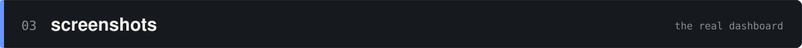</p>

<p align="center">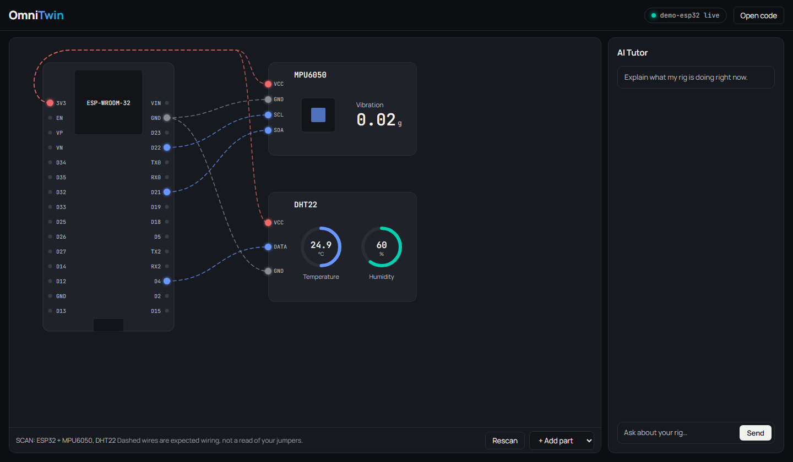</p>
<p align="center"><sub><b>The live twin.</b> Your board, your parts and their readings on one screen.</sub></p>

| | |
|:---:|:---:|
| 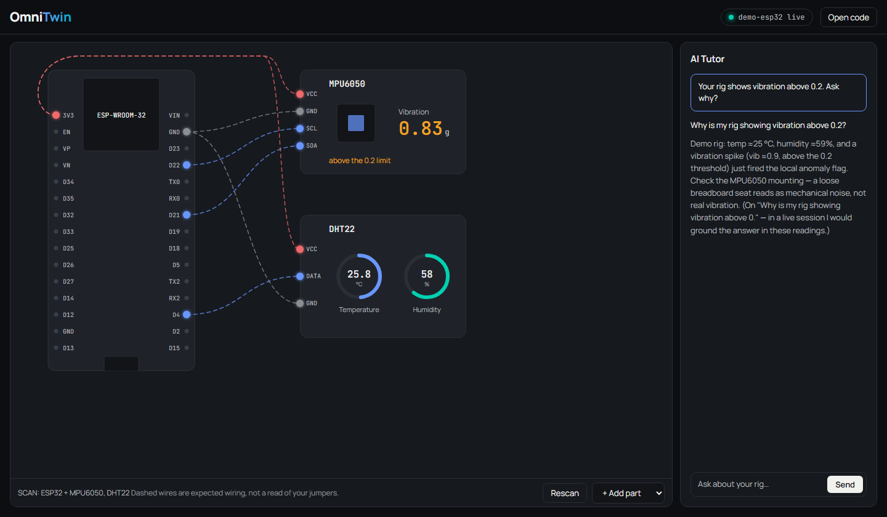 | 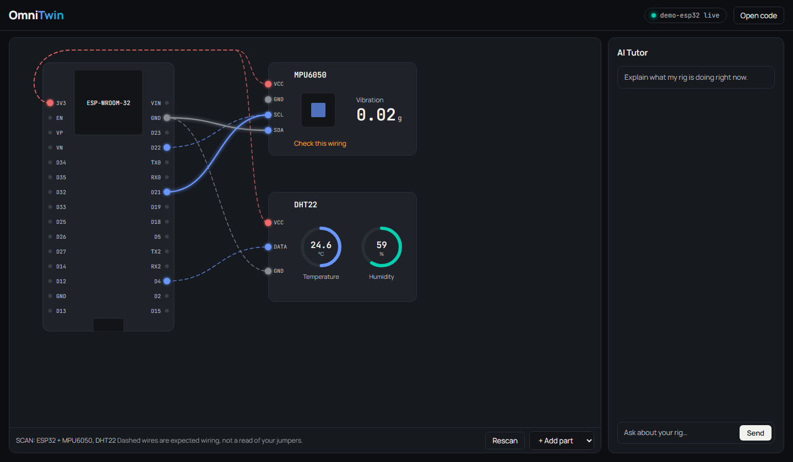 |
| **A reading crosses its limit.** One click asks the tutor why. | **A wrong wire.** Flagged on the card, with no AI cost. |
| 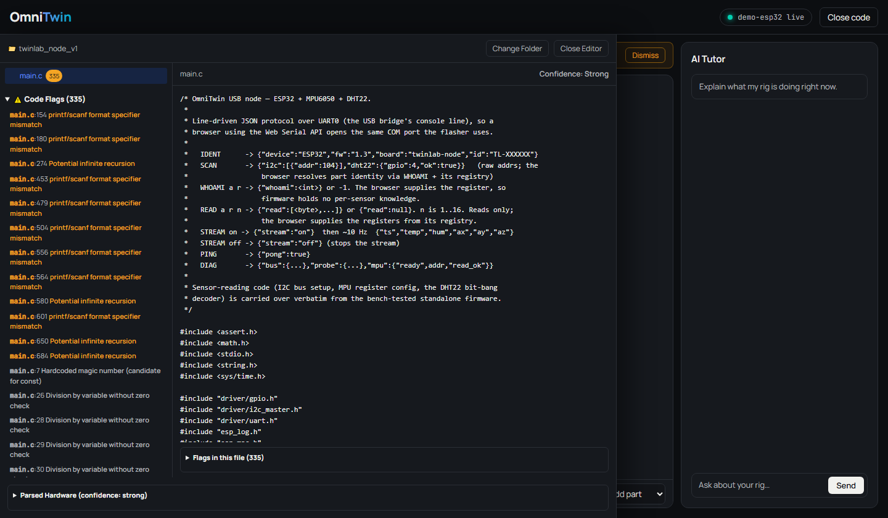 | 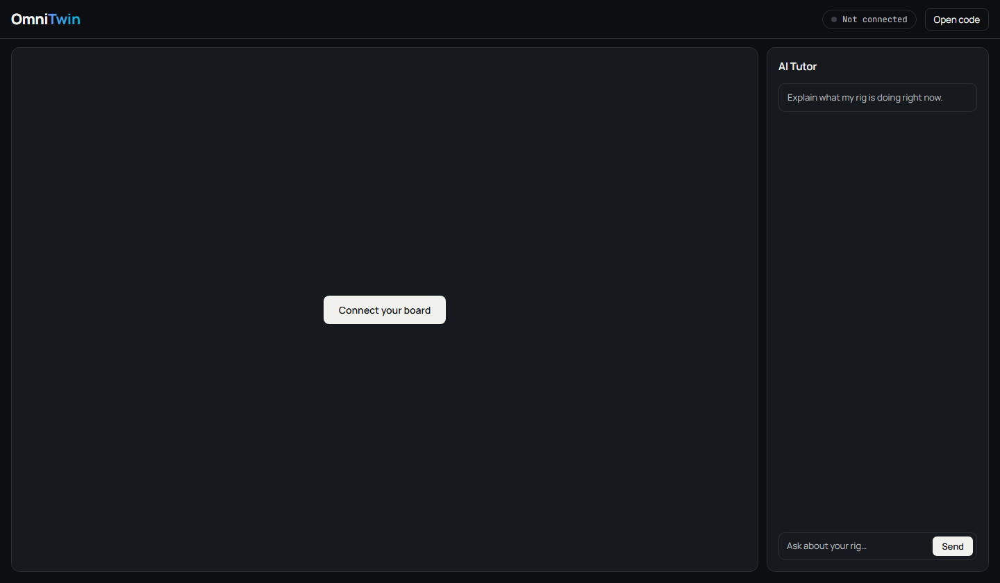 |
| **The code drawer.** Your source, with static checks. | **The start.** One button. |

<p align="center"><sub>Captured from the dashboard's <code>?demo=1</code> mode, which uses simulated readings and canned tutor replies.</sub></p>

<p align="center"></p>

<p align="center">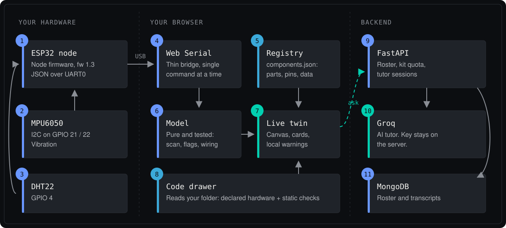</p>

Sensor data goes straight from the USB port to your browser. It doesn't pass through the backend, which only stores the roster and runs the tutor. The Groq key stays on the server.

<p align="center">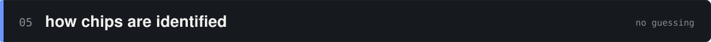</p>

<p align="center">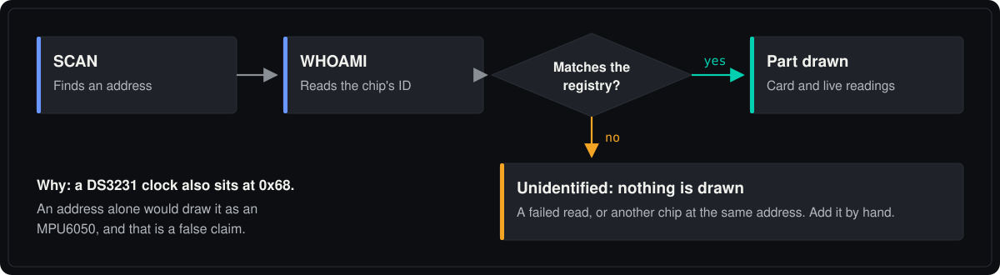</p>

**Adding an I2C sensor** starts with an entry in [`components.json`](frontend/src/registry/components.json):

| You add | You get |
|---|---|
| `whoamiReg` and `whoamiVal` | The chip is identified and gets a card |
| `readRegs` | Live data, polled over `READ` |
| `display` | Its own gauges and labels |

Polling only reads, so a chip that must be configured before it measures still needs firmware support.

<p align="center">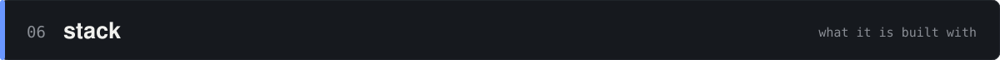</p>

<p align="center">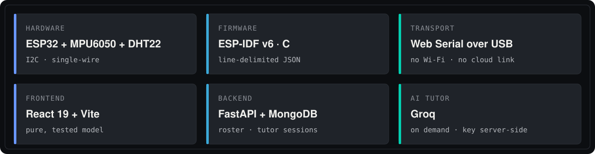</p>

<p align="center">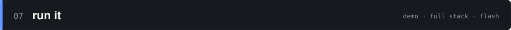</p>

**See it with no hardware.** You need Node.js:

```powershell
cd frontend
npm install
npm run dev
```

Then open <http://localhost:5173/?demo=1>.

**Run the full stack.** You also need Windows, Python 3.13, MongoDB 7 on `:27017`, and Chrome or Edge for Web Serial:

```powershell
python -m venv .venv
.\.venv\Scripts\python -m pip install -r requirements.txt
cd frontend; npm install; cd ..

# For the AI tutor, add GROQ_API_KEY=... to backend/.env

powershell -File .\run.ps1         # dashboard :5173, API docs :8000/docs
powershell -File .\run.ps1 -Stop   # stop both
```

`run.ps1` hardcodes `D:\OmniTwin`, so edit it if your clone lives elsewhere.

**Flash the board** with ESP-IDF v6.0.2 active, then check it over serial:

```powershell
cd firmware\twinlab_node_v1
idf.py build
idf.py -p COM3 flash

# from the repo root, using the ESP-IDF Python
python firmware\verify_node.py COM3
```

**Wire the kit:**

| Part | Part pin | ESP32 pin | Note |
|---|---|---|---|
| **MPU6050** | VCC / GND | 3V3 / GND | |
| | SDA / SCL | GPIO 21 / GPIO 22 | |
| **DHT22** | VCC / GND | 3V3 / GND | |
| | DATA | GPIO 4 | 4.7k to 10k pull-up to 3V3 |

The board keeps working with sensors unplugged. Plug one in and click **Rescan**.

**Run the tests** from the repo root:

```powershell
node --test "frontend/tests/*.test.mjs"
.\.venv\Scripts\python -m pytest tests -q
```

<p align="center">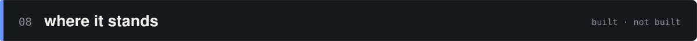</p>

| Working today | Not built yet |
|---|---|
| ESP32 node firmware, checked on real hardware | Billing and accounts |
| Live twin, wiring checks and local flags | LMS integration |
| On-demand AI tutor | Urdu interface |
| Source-derived hardware and code checks | Boards other than the ESP32 node |
| Device roster and demo-kit quota | |

Known limits:

- Source parsing is pattern-based and misses some common idioms. See the [audit](docs/audit-hardware-detection.md).
- The Arduino sketch hasn't been compiled or tested.
- Chrome or Edge on desktop only, because Web Serial requires it.

<p align="center">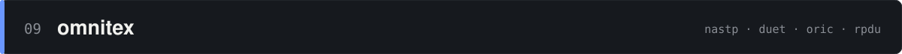</p>

OmniTwin is a product of [**OmniteX**](https://omnitex.netlify.app). We're based at NASTP Silicon Valley, Karachi, as part of Cohort 2 of the DUET ORIC Research Products Development Unit (RPDU).

<p align="center">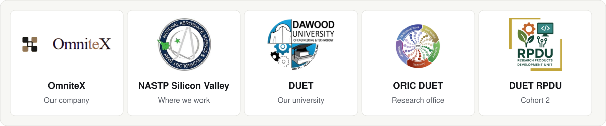</p>

<p align="center"><sub>Built in Karachi by <a href="https://github.com/Arhamurrahemeen">Arham</a>, founder of OmniteX.</sub></p>
